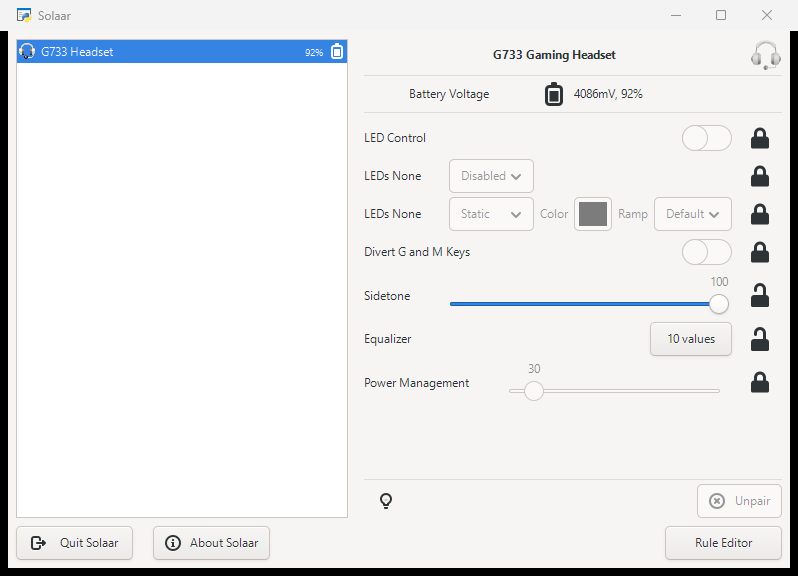

<div align="center">


# Solaar for Windows

**A lightweight, telemetry-free alternative to Logitech G HUB.**<br>
Sidetone, equalizer, battery and LEDs for Logitech G headsets, DPI and lights for wired Logitech G mice. No account, no background services, no data collection.

[](https://github.com/jazzvier1/Solaar-Windows/releases/latest)
[](https://github.com/jazzvier1/Solaar-Windows/releases)
[](https://github.com/jazzvier1/Solaar-Windows/actions/workflows/windows.yml)

[](LICENSE.txt)

### [⬇ Download Solaar-Windows.zip](https://github.com/jazzvier1/Solaar-Windows/releases/latest/download/Solaar-Windows.zip)



</div>

> [!NOTE]
> This is a **Windows-only** port of [Solaar](https://github.com/pwr-Solaar/Solaar).
> On Linux, use the original project.

## Why

|  | Solaar for Windows |
|---|---|
| Download | 35 MB zip, nothing to install, no admin rights |
| Running | 1 process; ~5 MB of RAM while in the tray (~60 MB with the window open) |
| Account / telemetry / network | None. It only talks to your device over USB |
| Settings | Kept in a plain text file you can read: `%USERPROFILE%\.config\solaar\config.yaml` |

## Quick start

1. Download **[Solaar-Windows.zip](https://github.com/jazzvier1/Solaar-Windows/releases/latest/download/Solaar-Windows.zip)**.
2. Extract it anywhere, for example `C:\Tools\Solaar-Windows`.
3. Close G HUB (better: uninstall it), then double-click **`Solaar.bat`**.

If Windows says the file came from the internet, click *More info → Run anyway*,
or right-click the zip → *Properties* → *Unblock* before extracting.

## What works

Tested on: **G733** and **G935** headsets, **G203** wired mouse.

| Feature | Status |
|---|:---:|
| Sidetone | ✅ |
| 10-band equalizer | ✅ |
| Battery level and voltage | ✅ |
| LED effects | ✅ read · changing them is untested |
| Tray icon, start minimized | ✅ |
| Wired Logitech G mice: DPI and lights | ✅ G203 (other models: feedback welcome) |
| Blue VO!CE | ❌ |
| Mice and keyboards on Unifying / Bolt / Lightspeed receivers | ❌ not yet |
| Rules and key remapping | ❌ Linux only |

**Blue VO!CE** is not a headset setting: G HUB applies it to your microphone audio on the PC.
Solaar only changes settings stored in the device, so it cannot provide it.

Other Logitech G headsets that use the same HID++ interface (usage page `FF43`) should work too, but are untested.
If you try one, please [open an issue](https://github.com/jazzvier1/Solaar-Windows/issues) with the output of `solaar-cli show`.

## Usage

- **Start with Windows, minimized to the tray:** press `Win+R`, type `shell:startup`, and in that folder create a
  shortcut to `Solaar.bat` with ` --window=hide` added at the end of its *Target*.
- **Command line:** in the extracted folder, `solaar-cli show` lists every device and its settings;
  `solaar-cli config G733 sidetone 50` changes one setting. The equalizer is edited from the window (*10 values*).
- **Memory:** while Solaar sits in the tray it hands unused memory back to Windows (~5 MB);
  opening the window brings it back to ~60 MB (Python + GTK).

### Troubleshooting

- **Device not listed:** quit G HUB completely (including `lghub_agent` and `lghub_updater`), unplug and replug the
  dongle, then run `solaar-cli show`.
- **Settings change back by themselves:** G HUB is still running and re-applying its own profile.
- **Mouse DPI does not change:** set *Onboard Profiles* to *Disabled* in Solaar first; while an onboard profile is
  active the mouse uses the DPI stored in that profile.
- **Report a device that is not detected:** close Solaar and run `solaar-cli -dd show`; the `Found device ... usage`
  lines show what Windows exposes. Paste them in an issue.

## Build from source

1. Install [MSYS2](https://www.msys2.org/) (or `winget install MSYS2.MSYS2`), then in the **MSYS2 UCRT64** shell:

   ```bash
   pacman -S --needed git zip mingw-w64-ucrt-x86_64-ntldd mingw-w64-ucrt-x86_64-gtk3 mingw-w64-ucrt-x86_64-python-gobject mingw-w64-ucrt-x86_64-python-yaml mingw-w64-ucrt-x86_64-python-psutil mingw-w64-ucrt-x86_64-python-typing_extensions mingw-w64-ucrt-x86_64-hidapi mingw-w64-ucrt-x86_64-adwaita-icon-theme
   git clone https://github.com/jazzvier1/Solaar-Windows.git && cd Solaar-Windows
   ```

2. Run it with `python bin/solaar`, or build `dist/Solaar-Windows.zip` with `bash packaging/windows/build.sh`.

### What the port changes

Solaar already had a [hidapi](https://github.com/libusb/hidapi) backend for non-Linux systems. The port adds:

- HID++ detection by HID collection usage, because Windows rejects the probe Solaar uses on Linux
  (`lib/hidapi/hidapi_impl.py`).
- Symbolic battery icons by default and releasing memory while hidden (`lib/solaar/`).
- A portable build with a trimmed MSYS2 runtime (`packaging/windows/`).

All device support comes from upstream Solaar; see [its documentation](https://pwr-solaar.github.io/Solaar/)
for details on devices and settings.

## Credits

- **[Solaar](https://github.com/pwr-Solaar/Solaar)** was created by Daniel Pavel ([@pwr](https://github.com/pwr))
  and is maintained by Peter F. Patel-Schneider ([@pfps](https://github.com/pfps)) together with
  [many contributors](https://github.com/pwr-Solaar/Solaar/graphs/contributors). This port would not exist without their work.
- **Windows port:** [@jazzvier1](https://github.com/jazzvier1).
- Built on [hidapi](https://github.com/libusb/hidapi), [GTK](https://www.gtk.org/),
  [PyGObject](https://pygobject.gnome.org/) and [MSYS2](https://www.msys2.org/).

Not affiliated with or endorsed by Logitech. Logitech, G HUB and Blue VO!CE are trademarks of Logitech.

## License

[GNU General Public License v2.0 or later](LICENSE.txt), the same as Solaar.
